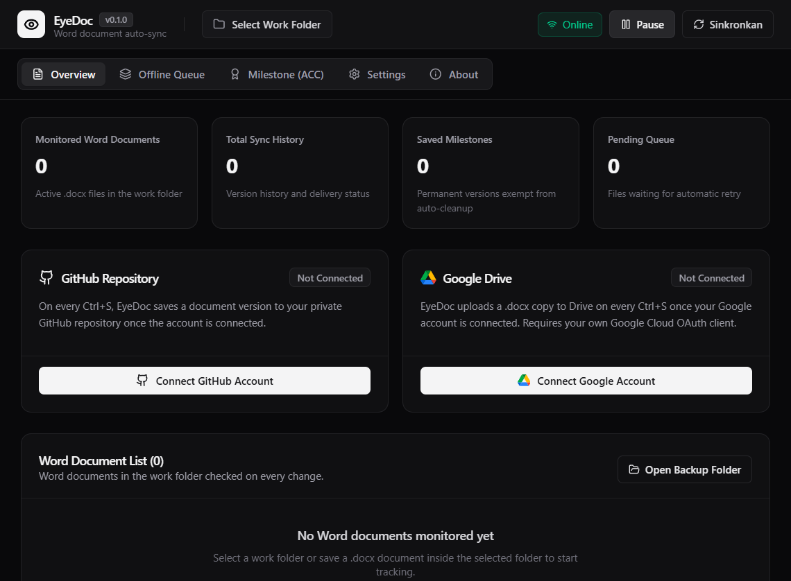

# EyeDoc

Ctrl+S docx, auto-save versi, upload ke GitHub/Google Drive. No server.

[](https://github.com/miezlearning/eyedoc/actions)
[](https://github.com/miezlearning/eyedoc/releases)



## Run

```bash
npm install
npm run tauri dev
```

Build installer: `npm run tauri build` → `src-tauri/target/release/bundle/`

## Setup

1. Pilih folder di Settings.
2. GitHub: Connect → masukkan kode di `github.com/login/device`.
3. Google: buat OAuth client tipe Desktop app, redirect `http://127.0.0.1:8585/`, tempel ID + secret.

Config: `%APPDATA%\eyedoc\config.json`

## Yang terjadi

- Tiap save → salinan di `Backups/`, catatan revisi (kata, heading, gambar).
- Milestone = versi yang tidak dihapus retensi.
- Offline → antrean, retry tiap 15 detik.
- Tray, 5 tab, EN/ID.

## Notes

Tauri v2 + Rust. Bukan Electron. UI pakai WebView2.

RAM ~162 MB setelah tuning (sekitar 4,7 MB itu proses Rust, sisanya WebView2).

Tambah bahasa: salin `src/locales/en.ts` jadi `xx.ts`. Auto-kenal.
