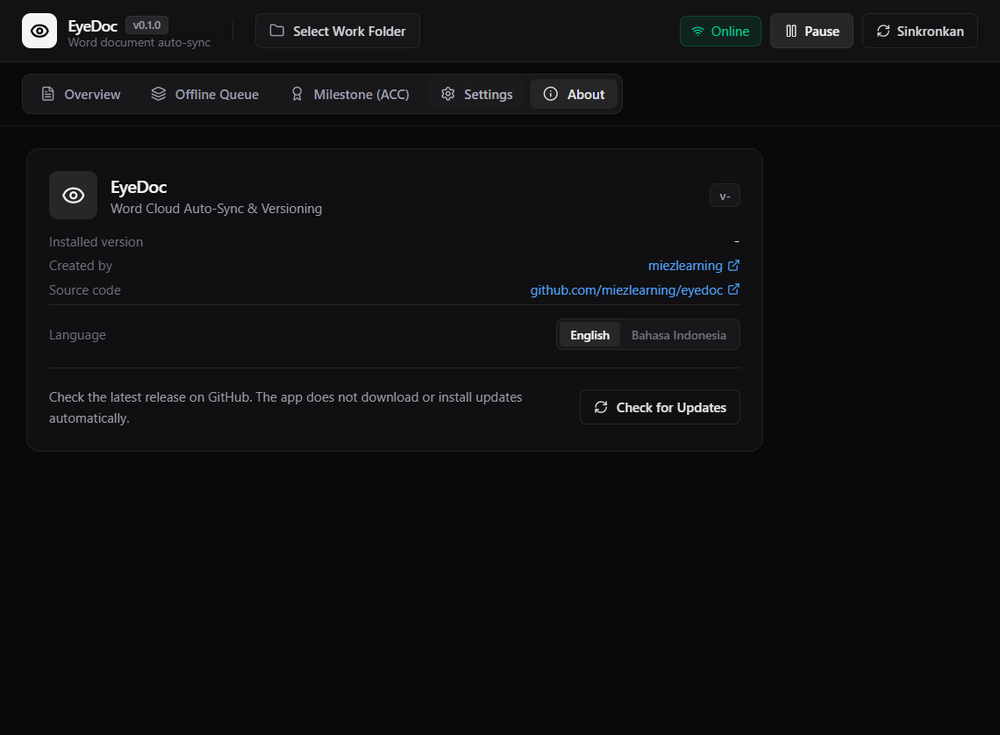

# EyeDoc

Aplikasi desktop yang menjaga setiap versi dokumen Word kamu. Simpan Ctrl+S, EyeDoc menyimpan salinan bernomor, merangkum apa yang berubah, lalu mengirimnya ke GitHub atau Google Drive.

[](https://github.com/miezlearning/eyedoc/actions/workflows/build-and-release.yml)
[](https://github.com/miezlearning/eyedoc/releases)
[](https://github.com/miezlearning/eyedoc/releases)
[](https://github.com/miezlearning/eyedoc/stargazers)
[](https://github.com/miezlearning/eyedoc/issues)
[](https://github.com/miezlearning/eyedoc/commits/master)

Badge di atas diambil langsung dari GitHub, jadi angkanya berubah sendiri tanpa diedit manual.

## Tampilan

Dashboard, lima tab, dan kartu status cloud:


Halaman Tentang berisi versi, tautan source, cek pembaruan, dan pemilih bahasa:



## Cara kerja singkat

```
Word (.docx) disimpan
   ↓
watcher mendeteksi perubahan
   ↓
parser membaca kata, heading, dan gambar dari document.xml
   ↓
salinan versi dibuat di folder Backups
   ↓
upload ke GitHub / Google Drive, atau masuk antrean saat offline
```

## Angka dari kode ini

Ini bukan angka promosi, melainkan nilai yang memang dipakai aplikasi:

| Hal | Nilai | Sumber |
| --- | --- | --- |
| Tipe aplikasi | Desktop, Tauri v2 | `src-tauri/Cargo.toml` |
| Bahasa UI bawaan | English | `src/locales/en.ts` |
| Bahasa tersedia | 2, gampang ditambah | `src/locales/` |
| Jumlah tab | 5 | `src/App.tsx` |
| Debounce penyimpanan | 1,8 detik setelah event terakhir | `src-tauri/src/watcher.rs` |
| Pindai cadangan berkala | tiap 15 detik | `src-tauri/src/lib.rs` |
| Retensi versi bawaan | 25 versi | `src-tauri/src/config.rs` |
| Port OAuth Google | 8585, fallback port acak | `src-tauri/src/gdrive.rs` |
| Cek pembaruan | GitHub Releases API | `src-tauri/src/lib.rs` |

## Yang bisa dilakukan

- Memantau folder kerja dan membuat versi baru setiap kali dokumen disimpan.
- Membaca struktur `.docx` langsung dari ZIP dan XML, tanpa memasang Microsoft Word.
- Merangkum revisi, termasuk heading baru, perubahan kata per bagian, dan jumlah gambar.
- Menyimpan milestone permanen yang tidak terhapus oleh retensi.
- Mengantre upload saat internet mati dan mengirim ulang saat Online kembali.
- Masuk lewat GitHub Device Flow atau Google OAuth milik sendiri.
- Berjalan di system tray dan mendukung lebih dari satu bahasa.

## Kenapa ringan

EyeDoc memakai **Tauri v2, bukan Electron**. Bedanya: Tauri tidak mengirim mesin browser dan runtime Node.js di dalam installer. Tampilan memakai WebView2 yang sudah tersedia di Windows, logika aplikasi ditulis dalam Rust.

Perbandingan ini soal arsitektur:

| Aspek | EyeDoc (Tauri) | Aplikasi desktop berbasis Electron pada umumnya |
| --- | --- | --- |
| Mesin tampilan | Memakai WebView2 yang sudah ada di Windows | Menyertakan mesin browser sendiri di installer |
| Runtime aplikasi | Backend Rust, frontend sudah jadi file statis | Node.js ikut terbungkus bersama aplikasi |
| Pembaca `.docx` | `zip` + `quick-xml`, baca `document.xml` langsung | Sering memakai pustaka besar atau otomatisasi Word |
| Butuh server | Tidak. Semua data ada di komputermu | Sering bergantung pada layanan cloud untuk masuk |
| Instalasi | Satu file MSI atau Setup.exe | Biasanya lebih besar karena membawa browser |

Yang dirasakan pemakai:

- Tidak perlu memasang Microsoft Word untuk membaca isi dokumen. EyeDoc membaca XML di dalam file `.docx`.
- Tidak perlu menyiapkan database atau server. Konfigurasi cukup satu file JSON di `%APPDATA%\eyedoc`.
- Tetap jalan tanpa internet. Saat offline, upload ditunda dan dikirim begitu koneksi kembali.
- Satu tombol untuk hal yang paling sering dipakai: pilih folder, lalu biarkan watcher bekerja.

### Angka hasil pengukuran

Diukur dari artifact build di mesin pengembang. Angka di mesin lain bisa berbeda.

| Yang diukur | Hasil |
| --- | --- |
| `eyedoc.exe` release | 7,55 MB |
| Installer MSI | 3,75 MB |
| Installer Setup.exe (NSIS) | 2,68 MB |
| Total aset frontend di `dist/` | 0,36 MB |
| Proses Rust `eyedoc` (private) | 6,2 MB |
| Proses Rust `eyedoc` (working set) | 26,6 MB |
| Enam proses WebView2 (private) | 174,6 MB |
| Total memori private semua proses | 180,8 MB |
| Total working set semua proses | 364,8 MB |
| CPU proses `eyedoc` dalam 6 detik pertama | 0,31 detik |

Catatan jujurnya: *private* adalah memori yang benar-benar dipakai proses itu sendiri, sedangkan *working set* ikut menghitung halaman yang dipakai bersama aplikasi lain. Jadi 180,8 MB lebih mewakili biaya sebenarnya daripada 364,8 MB.

Dari angka itu terlihat bahwa bagian Rust hanya **6,2 MB**. Sisanya adalah WebView2, mesin browser bawaan Windows yang dipakai untuk merender tampilan. Memori tidak nol, dan Tauri tidak bisa menghilangkannya tanpa mengganti UI ke widget native. Keuntungannya tetap ada di ukuran unduhan, tidak adanya mesin browser yang ikut dikirim, dan fakta bahwa runtime WebView2 dipakai bersama aplikasi lain.

Angka development berbeda jauh, `target/debug/eyedoc.exe` berukuran 305,51 MB karena membawa simbol debug. Itu bukan yang didistribusikan.

## Kenapa ini relevan sekarang

- Revisi dokumen sering datang berturut-turut. EyeDoc menyimpan jejaknya tanpa perlu kamu mengganti nama file sendiri.
- File tugas akhir atau laporan mudah tertimpa. Salinan versi otomatis mengurangi risiko kehilangan bagian yang sudah selesai.
- Banyak orang berpindah antara laptop dan komputer lain. GitHub atau Google Drive dipakai sebagai tempat penyimpanan, bukan server milik sendiri.
- Privasi tetap terjaga. Token dan konfigurasi ada di komputer pemakai, tidak dikirim ke pihak ketiga selain layanan cloud yang sengaja dipilih.
- Antarmukanya bisa berganti bahasa. Menambah bahasa baru cukup dengan satu file di `src/locales/`.

## Pasang

Unduh installer dari [halaman Releases](https://github.com/miezlearning/eyedoc/releases):

- `EyeDoc_1.0.0_x64_en-US.msi`
- `EyeDoc_1.0.0_x64-setup.exe`

Keduanya dibuat otomatis oleh GitHub Actions setiap ada push ke `master`. Tidak ada server atau hosting yang perlu disiapkan.

Kalau ingin membangun sendiri:

```bash
npm install
npm run tauri dev
```

## Menambah bahasa

Teks UI tersimpan satu file per bahasa di `src/locales/`. Caranya:

1. Salin `en.ts` menjadi misalnya `fr.ts`.
2. Isi `code`, `name`, dan pasangan teks Inggris ke terjemahan.
3. Simpan. Bahasa itu otomatis muncul di halaman Tentang.

Detail ada di `src/locales/README.md`. Terjemahan yang belum ada akan memakai teks English, jadi aplikasi tetap bisa dipakai.

## Catatan

Google Drive memerlukan OAuth client milik sendiri. Buat OAuth client bertipe Desktop app di Google Cloud Console, lalu daftarkan `http://127.0.0.1:8585/` sebagai redirect URI. Kredensial tidak disimpan di source kode.
